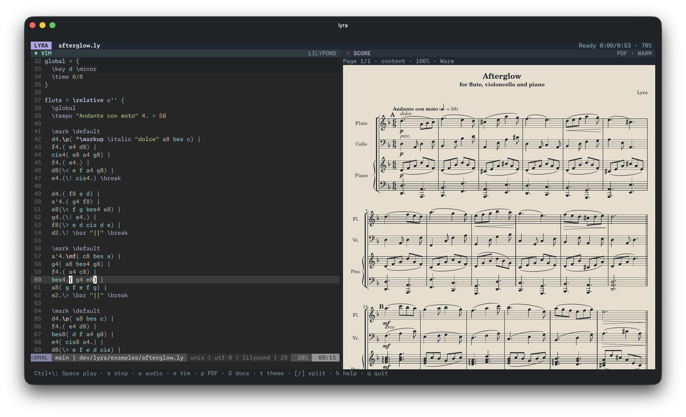

# Lyra

Write music. Hear music. Stay in Vim.

Lyra is a Go terminal-native LilyPond music workstation for macOS Apple Silicon.
It runs genuine traditional Vim inside one Bubble Tea/Lip Gloss interface and
interprets Vim's PTY output with a VT emulator.



Editing [Afterglow](examples/afterglow.ly), a one-page score for flute, cello and
piano, with an in-terminal PDF preview.

**Current milestone: Phase 4 playback.** Genuine embedded Vim, compile-on-save,
diagnostics, in-terminal PDF preview and MIDI playback are implemented. FluidSynth
prepares audio in the background; mpv provides play/pause, stop, seeking, volume
and a timeline. Real synthesis, transport and process cleanup tests pass. Native
speaker output qualification remains open: mpv's CoreAudio backend stalls on this
machine, including when run independently of Lyra.
PDF graphics still have a separate Ghostty/Kitty visual acceptance gate; see
[verification notes](docs/VERIFICATION.md).

## Build and run

Requires Go 1.26.5 or later, traditional Vim on PATH, and an interactive terminal.
This implementation was developed on macOS/arm64 with Homebrew Vim 9.2. PDF preview
targets Ghostty and Kitty with a successful graphics probe and pixel-size reply.
Editing and build diagnostics continue in terminals without graphics support.
`make install` installs the Homebrew dependencies and the Lyra executable.
Missing LilyPond is reported in the build pane while editing continues.

```sh
cd ~/dev/lyra
make install
lyra examples/playback.ly
```

Run `lyra` without a filename to open a startup chooser:

- **Open a score** browses folders and existing `.ly` files. Use arrows or `j`/`k`
  to select, Enter to open, and Left to go to the parent folder. `.` toggles hidden
  files, `~` goes home, and `/` lets you enter a path directly.
- **Open Recent** (or `r` from the menu) lists the last 20 scores opened in Lyra,
  newest first, with their paths. Use arrows or `j`/`k` and Enter to reopen a score;
  Esc returns to the menu. Missing or inaccessible files show an error so you can
  choose another score. Command-line launches and new scores also enter history.
- **Create a score** lets you browse to a folder, then press `n` to choose the
  filename and location. Lyra suggests a musical name such as `starlit-cadenza.ly`;
  edit it or use Ctrl+U to enter a different path. Enter continues to a template
  picker. Existing files are refused, and `.ly` is added when omitted.

The template picker starts with **Blank score** and includes all 22 template
topics from the [LilyPond Learning Manual](https://lilypond.org/doc/v2.26/Documentation/learning/templates):
single staff, piano, string quartet, vocal ensembles, orchestra, ancient notation
and jazz, plus the built-in SATB/SSAATTBB starters. Names combine their section and
subsection, such as **Single staff · Notes only**. Type to search, use Up/Down or
Ctrl+N/Ctrl+P to select, and Enter to create the file and open it in Vim. Ctrl+U
clears the query and restores the blank option; Esc returns to the filename.
Search accepts reordered words, partial words, common instrument aliases and
small spelling mistakes: try `single staff notes only`, `quartet string`,
`str qrt`, `violins viola cello`, or `lead sheet chords lyrics`.

Templates are bundled from the official 2.26 manual and work offline. The selected
code, version and source attribution are written to the new permanent score;
blank creates a genuinely empty file. The file is created only when the template
or blank choice is confirmed. Cancelling the picker creates nothing, and a path
that appears while you search is refused. User scores are never replaced.

Path fields support Tab completion, spaces, Unicode and `~/`. Relative paths
start in the displayed folder. Esc goes back, and `q` in the menu/browser or
Ctrl+C exits. Browsing or cancelling creates no score. The destination folder
must already exist; the chosen score is a permanent file and remains on exit.

Vim starts after you choose a score. The first `:w` saves normally, and
compile-on-save, relative includes, PDF preview and playback follow the selected
file. `lyra path/to/score.ly` still opens that file directly without the chooser.
Recent paths are saved privately in `~/Library/Application Support/lyra/recent.json`
on macOS (`$XDG_CONFIG_HOME/lyra/recent.json`, or `~/.config/lyra/recent.json`, on
Linux). History failures do not prevent editing.

Homebrew must already be installed and on PATH. `make install` runs `make deps`
using the project's [Brewfile](Brewfile) (Go, Vim, LilyPond, Poppler, FluidSynth and mpv), builds
Lyra, then installs it at `~/.local/bin/lyra`. Existing Homebrew formulae are reused
without requesting upgrades. It also installs the pinned GeneralUser GS SoundFont
and its license under `~/.local/share/lyra/soundfonts` (or `$XDG_DATA_HOME/lyra`).

If `~/.local/bin` is not on your shell's PATH, add this to your shell configuration:

```sh
export PATH="$HOME/.local/bin:$PATH"
```

Install dependencies alone with `make deps`. Override the destination with
`make install BINDIR=/your/bin`. For a local build without dependency installation:

```sh
make build
./bin/lyra examples/playback.ly
```

Choose a different traditional Vim executable if needed:

```sh
./bin/lyra --vim /usr/bin/vim composition.ly
```

Compiler options:

```sh
./bin/lyra --lilypond /path/to/lilypond --include shared --build-timeout 2m composition.ly
```

Repeat `--include` for multiple search directories. Relative include directories
are resolved from Lyra's launch directory. All flags precede the score filename.
Use `--pdfinfo /path/to/pdfinfo --pdftoppm /path/to/pdftoppm` for custom Poppler tools.

Flags precede the filename; use `--` for a filename beginning with `-`. Paths with
spaces work. A new explicitly named source is created when you save it in Vim;
the startup chooser creates a new score only after you confirm its template or
blank choice at the selected location. The
`--vim` value is one executable path, not a shell command. Neovim is rejected,
including when it is renamed or symlinked to `vim`.

Lyra uses your normal `.vimrc`, runtime, plugins and mappings. It neither rewrites
configuration nor starts Vim in clean mode. Vim receives an emulated
`xterm-256color` environment rather than inheriting the host's terminal identity.
The active terminal is assumed to support ordinary VT control sequences and a
UTF-8 locale. See [feasibility and limitations](docs/FEASIBILITY.md).

## Appearance

Lyra adds a session-local LilyPond palette to `.ly` and `.ily` buffers: lavender
commands, teal pitches, gold durations, rose dynamics/rests, and separate colors
for comments, strings, markup and embedded Scheme. Your `.vimrc`, plugins,
mappings, colorscheme and other filetypes still load normally. The palette has
both truecolor and 256-color values and never changes `Normal` or shared syntax
groups. Use `--vim-style user` to keep your existing LilyPond syntax unchanged.

PDF preview starts with warm cream paper and dark notation. Press `t` in PDF
focus, or `Ctrl+\` then `t` from Vim, to cycle **Warm → Night → Paper**. Night uses
charcoal paper and pale notation; Paper restores the original white appearance.
Colored annotations keep their hue and edges remain antialiased. The theme only
changes the terminal image; the score and engraved PDF are untouched. Start
directly in night mode with:

```sh
lyra --preview-theme night composition.ly
```

Header bars use a compact Lyra badge, a filename, playback status and distinct
pane backgrounds. A teal filled dot identifies the focused pane. Theme changes
preserve the split, page, zoom and scroll position. Appearance choices last for
the current session; saved configuration is still planned.

## Controls

Start in the editor. Use `i`, Esc, `:w`, `:q`, `:wq`, visual mode and your existing
Vim mappings normally. Tab and Ctrl+C remain Vim input.

| Keys | Action |
| --- | --- |
| `Ctrl+\`, then `e` | Focus Vim |
| `Ctrl+\`, then `p` | Focus the score/status pane |
| `Ctrl+\`, then `o` | Open the latest successful PDF in the system's default viewer |
| `Ctrl+\`, then `d` | Focus build diagnostics |
| `Ctrl+\`, then `D` | Search the cached LilyPond manuals |
| `Ctrl+\`, then `a` | Focus playback and audio setup |
| `Ctrl+\`, then Space | Play / pause |
| `Ctrl+\`, then `s` | Stop and return to the beginning |
| `Ctrl+\`, then `,` / `.` | Seek backward / forward 5 seconds |
| `Ctrl+\`, then `u` | Play the latest prepared take from the beginning |
| `Ctrl+\`, then `[` / `]` | Narrow / widen the editor by 5% of terminal width |
| `Ctrl+\`, then `=` | Reset to half editor, half preview |
| `Ctrl+\`, then `m` | Toggle mouse: drag divider and scroll preview |
| `Ctrl+\`, then `t` | Cycle warm, night and original white PDF paper |
| `Ctrl+\`, then `b` | Rebuild the saved launch score |
| `Ctrl+\`, then `c` | Cancel pending/active engraving |
| `Ctrl+\`, then `h` or `?` | Show help |
| `Ctrl+\`, then `q` | Ask Vim to quit; confirm unsaved buffers in Vim |
| `Ctrl+\`, then `Ctrl+\` | Send a literal Ctrl+\ to Vim |
| `q` or Esc in preview | Return to Vim |
| `n` / `p` in PDF preview | Next / previous page (also Page Down / Page Up) |
| `+` / `-` / `0` in PDF preview | Zoom in / out / reset current fit |
| `f` in PDF preview | Toggle content-width fit / full-page fit |
| `t` in PDF preview | Cycle PDF paper theme |
| `h` / `j` / `k` / `l` or arrows in PDF preview | Scroll left / down / up / right |
| `r` in PDF preview | Reload viewport and force a full redraw |
| `d` in PDF preview or diagnostics | Switch between PDF and build diagnostics |
| Space / `s` / `,` / `.` / `u` in PDF or audio focus | Playback controls as above |
| `+` / `-` in audio focus | Raise / lower playback volume |
| `0` in audio focus | Seek to the beginning |
| `j` / `k` in the build pane | Scroll diagnostics and output paths |
| `g` / `G` in the build pane | First / last visible section |
| `l` in the build pane | Toggle source diagnostics / raw compiler log |

Press the prefix, release it, then press the next key. Prefix combinations inside
bracketed paste remain literal data. Unknown combinations are forwarded to Vim.
A lone Esc is forwarded after a 25 ms delimiter-disambiguation delay. The command
prefix is the one reserved Vim input byte; configurability is planned.

At 88 columns or more the interface shows Vim and the score pane side by side.
The initial split is 50/50; the chosen proportion survives window resizing, with
at least 20 columns per pane. Smaller terminals show the focused pane. Resizing updates both Vim's virtual
screen and PTY. There are no tmux or separate-window dependencies.
Mouse mode starts off. Enable it with the prefix, then drag the divider with the
left button or scroll with a mouse wheel/trackpad over the preview. Editor mouse
coordinates are translated and encoded according to Vim's requested mouse mode.

## LilyPond documentation

Press **`K` over a word in normal Vim mode** to read the relevant manual section
inside Lyra. For example, `K` on `\tuplet` opens Tuplets. Lyra uses Vim's native
`keywordprg` mechanism in `.ly` and `.ily` buffers; existing `K` mappings and custom
keyword programs take precedence. `:LyraDocs key signature` performs an explicit
lookup. Use `--no-docs-key` to leave the default keyword program unchanged.

Press **`Ctrl+\`, then uppercase `D`** for fuzzy search across topic titles,
indexed commands and manual text. Type a command or concept, use Up/Down (or
Ctrl+N/Ctrl+P) to select, then Enter to read. Backspace edits the query and Ctrl+U
clears it. In a section, `j`/`k` or arrows scroll, Space/Page Down and Page Up page,
`g`/`G` jump to the ends, and `/` or `b` returns to the search results. Esc returns
to Vim; `q` also returns while reading. Prefix `p` restores the score preview,
including its current page and zoom. Opt-in mouse scrolling works in docs too.

The docs pane uses the adjustable right-hand split; below 88 columns it fills the
focused view. The first lookup downloads the official English **Notation
Reference** and **Learning Manual** from [lilypond.org](https://lilypond.org/doc/v2.26/Documentation/web/manuals.html)
and builds a local section/command index in the background. Subsequent sessions
work offline from the cache. Ctrl+R refreshes the manuals, with `R` as an alias
while reading. A failed refresh keeps previously loaded documentation and the
offline cache. Download failures are shown in the pane while editing continues.

Docs default to the **2.26** series. Match another installed LilyPond series with
`lyra --docs-version 2.24 composition.ly`; each series has its own cache under
the platform cache directory (`~/Library/Caches/lyra/docs` on macOS, or
`$XDG_CACHE_HOME/lyra/docs` on Linux). No documentation is fetched until requested.
The reader renders prose, tables and indented LilyPond examples as terminal text.
Engraved example images are represented by labels and source links; it does not
render the manual's music images yet. Source attribution and GNU FDL license
links appear at the end of each section; the cached manuals include their license
sections. No downloaded content is executed, and no Vim configuration is edited.

## Engraving and includes

Lyra builds the **file passed on the command line or selected at startup**,
initially and after saves.
Opening another buffer in Vim does not change the build target. Save with `:w`
before a manual rebuild; unsaved buffer contents are never compiled.

An additive `BufWritePost` hook is loaded for this Vim session after normal
startup. It notifies saves of the launch score without changing `.vimrc`, user
autocommands or mappings. Directory watching catches external writes, included
files and atomic-save renames; a one-second fingerprint poll provides a fallback.
Changes are debounced for 200 ms. New requests invalidate and cancel stale work;
only one compiler runs at a time. The default timeout is two minutes.

Literal `\include "file.ily"` dependencies are tracked recursively, including
missing files that are created later. Nested includes use LilyPond's default
relative-include behavior, with `--include` directories as explicit fallbacks.
Comments and ordinary quoted strings do not create dependencies. Scheme-computed
includes, runtime search-path/relative-include changes and installed LilyPond
library files require a manual rebuild when changed. Scanning is bounded to
512 tracked paths, 4 MiB per file and 32 MiB per scan; limits appear in the pane.

Each generation writes into a private temporary directory, preserving PDFs/MIDI
beside your score. Successful outputs are published together; errors, cancellation
and obsolete builds keep the last good generation. Output paths appear in the
pane and remain available **during this session**. Lyra removes its temporary
outputs on exit. A MIDI-only score is supported; absence of MIDI or PDF is shown
explicitly. A successful compiler exit with neither artifact is an error.

Press `Ctrl+\`, then `o` to open the latest successful PDF in your system's
default PDF viewer (`open` on macOS, `xdg-open` on Linux). This also works after
a failed build, using the retained good PDF. The viewer receives a separate
session-local copy named after your score, so subsequent builds do not remove
the file it opened. Another explicit open updates that copy. Use the viewer's
Save As, Duplicate or Export command to keep it wherever you want before closing
Lyra. Missing viewers or launch failures appear in the footer and build pane;
editing and the terminal preview continue normally.

Diagnostics include filename, line, column and severity; `l` in diagnostics exposes
the bounded raw log (up to 256 KiB). `Ctrl+\ d` opens diagnostics from the editor.

## PDF preview

The first PDF in the last successful generation is previewed automatically.
Only the selected page is rasterized. Page, zoom and scroll position survive a
successful rebuild where valid; failed engraving keeps the last good image.
The preview owns a copy of the PDF, so replacing a compiler generation cannot
remove the document while it is being rasterized. All copies and caches are
session-local and removed on exit.

The default view trims blank paper margins, fits the printed content's width and
starts near the top of the music. A small margin is kept around the notation.
This makes short scores readable without fitting a mostly empty sheet of paper.
Footer text stays available by scrolling; it does not force the music to shrink
to fit the page height. Press `f` in preview to see the full paper page, or again
to return to content fit. `0` resets zoom and scroll in the selected fit mode.
The source score and its engraved PDF are unchanged.

The raster worker cancels superseded requests, caches up to four page rasters
within 64 MiB, limits the PDF to 64 MiB and a raster to 16 million pixels, and
crops onto the exact preview viewport before sending PNG data. Viewports are
limited to four million pixels and 4096 pixels per axis. Zoom ranges from 25% to
400% of the selected fit size; the raster's longest edge is capped at 4000 pixels.
Oversized documents/viewports produce a pane diagnostic while editing continues.

Host graphics and pixel-size replies are parsed by the existing raw reader,
including replies split across reads or arriving during a pending command prefix.
One frame compositor uses Bubble Tea's public `Raw` output path and Ultraviolet
text diffs, serializing text, image deletion/placement and cursor restoration.
Graphics never pass through styled text or use a second stdout writer. The owned
image is removed on help/diagnostics, narrow editor focus, resize and exit.

An unsupported terminal reports a useful status; there is no external PDF window
fallback. tmux, SSH and other graphics protocols are not yet qualified.

## Playback

The score needs a `\midi { }` block inside `\score`; `examples/playback.ly` is a
complete starting point. The first MIDI artifact from the last successful build
is copied into an audio-owned temporary directory and synthesized asynchronously.
PDF and audio come from the same successful compiler generation. A score without
MIDI is a normal state and editing/preview remain available.

**Playback starts only on request.** Saving can prepare a new take but never
starts it or interrupts a playing/paused take. `Ctrl+\ u` explicitly plays the
latest prepared take from its beginning. Otherwise, play/pause controls the current
take; after stop or EOF, the next Play uses the latest ready take. A play request
during preparation is queued and shown in the UI; Stop cancels that request.
A newer save also clears a queued play request.

The header shows status, current time, duration and volume. `Ctrl+\ a` opens the
timeline and audio diagnostics. Duration includes the rendered release/reverb
tail. Volume starts at 70% and ranges from 0–100%. No player window is opened.

The default bank is **GeneralUser GS 2.0.3 by S. Christian Collins**, installed
from the [author's repository](https://github.com/mrbumpy409/GeneralUser-GS) at
revision `684543d5e5efaef08d02be50dcda8d552478fa60`, with SHA-256 verification.
Its [complete license](docs/licenses/GeneralUser-GS.txt) is preserved alongside
the installed bank. The author's license permits music creation and software
project use; its sample-origin notes remain in the supplied license. No SoundFont
binary is bundled in the repository. `make soundfont` installs this bank alone.
The installer preserves an existing bank that differs from the pinned version.

Use your own bank or executables:

```sh
lyra --soundfont /path/to/bank.sf2 composition.ly
lyra --fluidsynth /path/to/fluidsynth --mpv /path/to/mpv composition.ly
```

`--soundfont` overrides `LYRA_SOUNDFONT`, then the installed default is used.
`--audio-output coreaudio` explicitly selects macOS output; the default is mpv's
platform choice. A stalled output produces an error after five seconds; Play
recreates the player and retries. In local macOS 26.6.2/mpv 0.41.0 checks,
CoreAudio initially passed, then stalled at zero even in standalone mpv;
AVFoundation advanced but hung on pause. Neither backend is qualified by this run.
Missing tools or a missing/invalid bank produce audio setup
diagnostics while Vim and PDF preview keep working. Lyra itself never downloads
tools or banks; only explicit install/dependency targets do so.

Synthesis writes stereo 44.1 kHz, signed 16-bit PCM WAV, with a two-minute timeout,
16 MiB MIDI limit and 512 MiB WAV limit. Stale synthesis is canceled and cannot
publish over a newer request. The current take and latest ready take are retained;
unused takes are deleted. mpv uses a private local Unix socket, bounded JSON
requests, disabled terminal input/output and an isolated configuration. Normal
exit and external cancellation kill/reap owned processes and remove temporary
MIDI/WAV files and control sockets.

## Development and tests

```sh
make check
make build
```

The suite uses real Vim in isolated temporary HOME directories. It covers screen
styling and query replies, alternate buffers, concurrent resize/snapshot access,
Unicode editing, configuration loading, unsaved confirmation, normal/abnormal
exit, raw input routing and a complete Bubble Tea application in an outer PTY.
It verifies terminal restoration on normal exit and SIGTERM. A missing Vim skips
the integration tests; install Vim before treating a run as acceptance evidence.
Real engraving/synthesis/player tests are enabled with:

```sh
LYRA_TEST_LILYPOND="$(command -v lilypond)" \
LYRA_TEST_SOUNDFONT="$HOME/.local/share/lyra/soundfonts/GeneralUser-GS.sf2" \
go test -race -timeout 90s ./...
```

These tests use silent mpv output. The separate opt-in
`LYRA_TEST_MACOS_AUDIO=1 go test -run TestMacOSAudioOutput ./internal/audio` also needs
both variables above and plays a brief low-volume sample through macOS output.

Source map:

```text
cmd/lyra/         CLI and signal context
internal/app/     Bubble Tea model, views, geometry, raw terminal lifecycle
internal/editor/  Vim process, PTY, VT emulator, ordered I/O
internal/input/   Raw prefix and bracketed-paste router
internal/lilypond/ Serialized compiler service, generation ownership, diagnostics
internal/watcher/ Parent-directory watches, fallback polling, include discovery
internal/preview/ Bounded asynchronous Poppler rasterization and Kitty backend
internal/audio/   Owned MIDI/WAV takes, FluidSynth worker, mpv JSON transport
internal/testdata/ Stable integration scores independent of user-edited examples
docs/             Feasibility assessment and verification notes
examples/         LilyPond score with layout and MIDI output
```

## Workstation roadmap

| Phase | Outcome | Status |
| --- | --- | --- |
| 1 | Embedded traditional Vim, terminal emulation and lifecycle | Implemented; see verification notes |
| 2 | Asynchronous LilyPond compile-on-save, diagnostics, last good output | Implemented; real LilyPond verified |
| 3 | Rasterized PDF inside Ghostty/Kitty, reload, pages, zoom and scrolling | Implemented; real PDF/PTY tests pass, native visual gate pending |
| 4 | FluidSynth/SoundFont MIDI synthesis and playback transport | Implemented; real synthesis/transport pass, native speaker output qualification open |
| 5 | Configuration, terminal matrix, packaging and polish | Planned |

LilyPond is the optional engraving dependency; Poppler (`pdfinfo`, `pdftoppm`)
provides PDF rasterization. Audio uses FluidSynth, a SoundFont and mpv.
Editing works without these tools. The application never installs tools or
SoundFonts automatically; `make deps` installs tools, `make soundfont` installs
the default bank, and `make install` includes both. Go dependencies are pinned.

## Known limits

- Actual Ghostty/Kitty visual qualification is pending. Automated frame/PNG tests
  do not establish graphics interoperability.
- The first generated PDF is displayed; selecting among separate book PDFs is
  not implemented. Pages within that document are navigable.
- Playback uses the first generated MIDI file. Selecting separate book outputs,
  live MIDI synthesis, tempo changes and score-position highlighting are future work.
- Mouse mode is opt-in; terminal-specific trackpad behavior needs visual testing.
- Vim extensions that require host-specific graphics, OSC clipboard forwarding,
  advanced keyboard negotiation or job-control suspension are not qualified.
  Loaded configuration is preserved, but not every terminal extension is supported.
- The emulator answers terminal queries using its own virtual terminal defaults;
  light/dark default-color synchronization with the host is future work.
- A slow Vim gets an ordered input queue capped at 8 MiB; exceeding it reports an
  error. Application subprocesses that detach from Vim's process group need further
  lifecycle qualification. Ctrl+Z suspension is outside Phase 1 acceptance.
- External termination uses SIGHUP and bounded forced cleanup. Normal quits use
  Vim's unsaved-buffer confirmation. SIGKILL or terminal loss cannot guarantee
  restoration or preservation of unsaved text; normal Vim swap recovery remains on.
- macOS/arm64 is the tested platform. Linux code is included but runtime support
  has not been qualified. Windows is not implemented.

Persistent development requirements are in [AGENTS.md](AGENTS.md), investigation
and primary sources in [docs/FEASIBILITY.md](docs/FEASIBILITY.md), and local test
evidence in [docs/VERIFICATION.md](docs/VERIFICATION.md).
